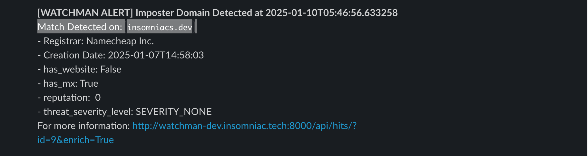

# Watchman
Watchman is a security tool that watches domains and fqdns. You can read more about it here: https://docs.google.com/presentation/d/10TtlZO01WfJo9raF-ShS06m5bak1NSG1/edit#slide=id.g324938c8159_1_85

## Pre-Req
1. AWS Creds
2. S3 Buckets

## Setup
1. git clone https://github.com/mwollenweber/Watchman.git
2. cd Watchman
2. cp example-config.rc config.rc
3. nano config.rc
4. sudo ./install.sh

### Add a Client
- http://localhost:8000/admin/Watchman/client/add/

### Add a Search
- http://localhost:8000/admin/Watchman/search/add/
I recommend adding the domain - (minus the) tld as a substring match and the domain+tld as str distance. So for insomniac.tech I monitor for the substring 'insomniac'

### Add Alert Config
http://localhost:8000/admin/Watchman/alertconfig/

## Run a daily zone update + match + alerts
1. ./run-daily.sh [config-file] [--shutdown]

`--shutdown` powers the system off when the run finishes. The user running it needs permission to shut down without a password prompt (root, or a passwordless sudo rule for `shutdown`).

### Run on every boot
On systemd hosts (e.g. Amazon Linux), install a service that runs `run-daily.sh` each time the system starts:
- sudo ./install-startup.sh

Use `--config FILE` for a config other than `config.rc`, `--dry-run` to preview the files it writes, and `--uninstall` to remove it. Logs: `journalctl -u watchman-daily`.

### Shut down after the daily run
To power the system off once each boot's run finishes (pairs with a scheduled instance start for a once-a-day job):
- sudo ./install-startup.sh --shutdown

This adds `--shutdown` to the service and a sudoers rule letting your user run only `shutdown -h now` without a password. The rule is checked with `visudo` before it's installed.

With a config other than `config.rc`:
- sudo ./install-startup.sh --shutdown --config prod.rc

Preview what it would install without changing anything:
- sudo ./install-startup.sh --shutdown --dry-run

To keep the system up for maintenance, stop the service after boot, before the run finishes:
- sudo systemctl stop watchman-daily

## Other Commands
### Update a Specific Zone:
Update a specific TLD. For Example, update .com: 
- python manage.py update_zone com

### See Search Results
- Browse to http://localhost:8000/hits/

### Example Slack Alert

### Example Email Alert

