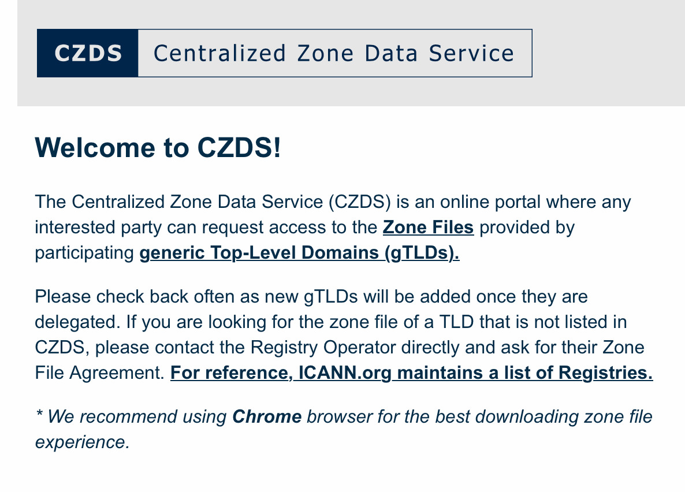
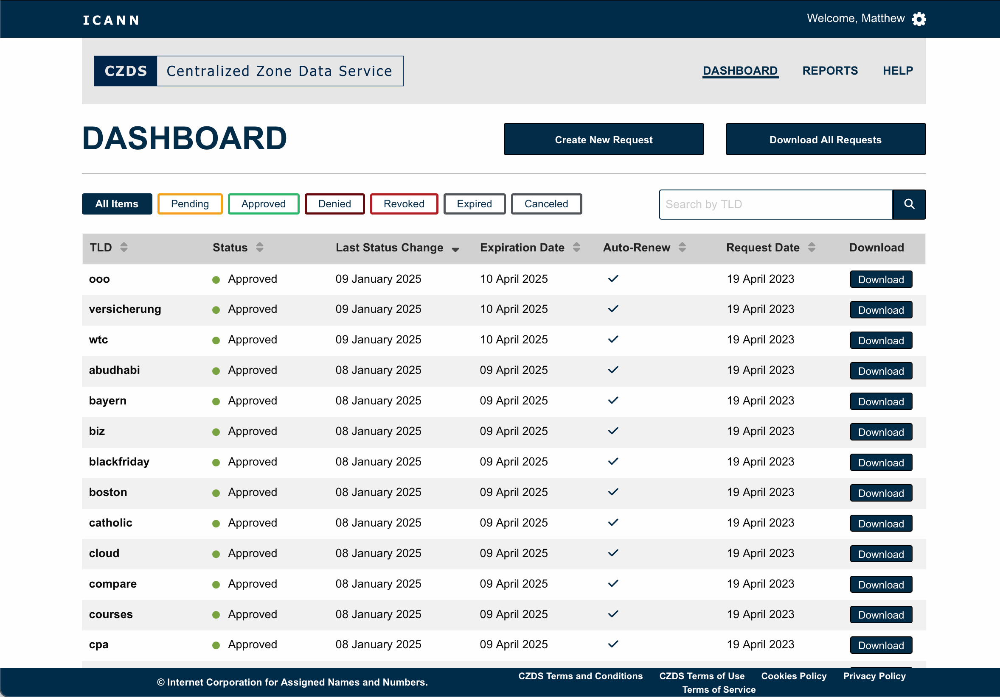
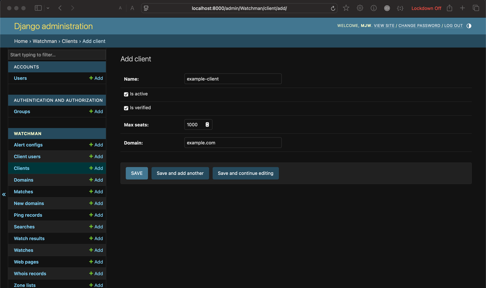
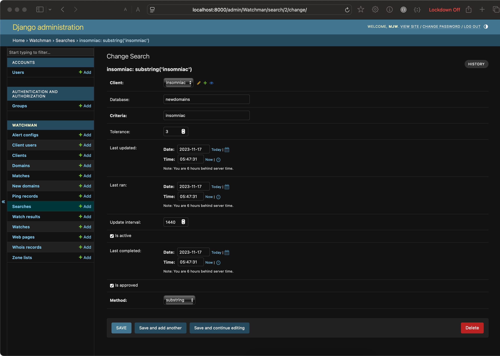
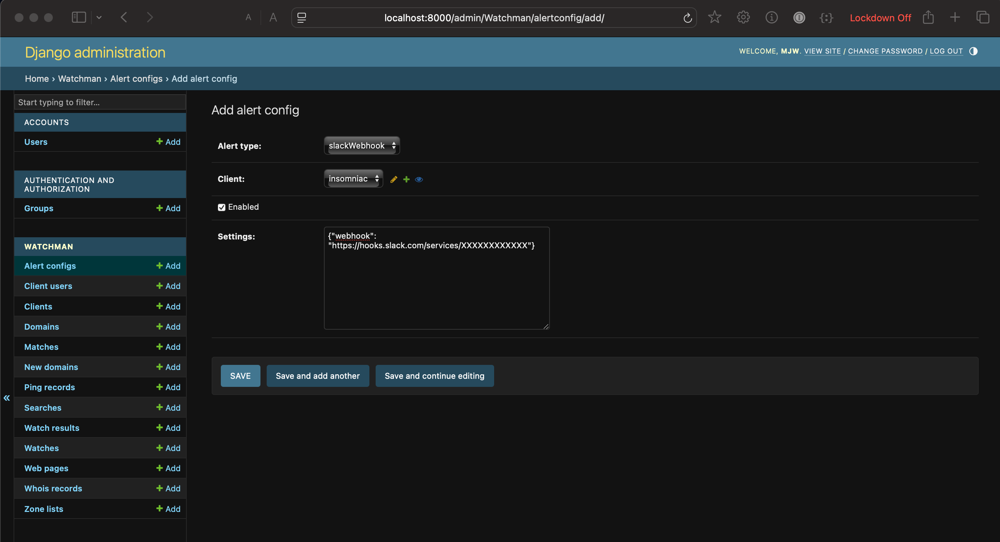
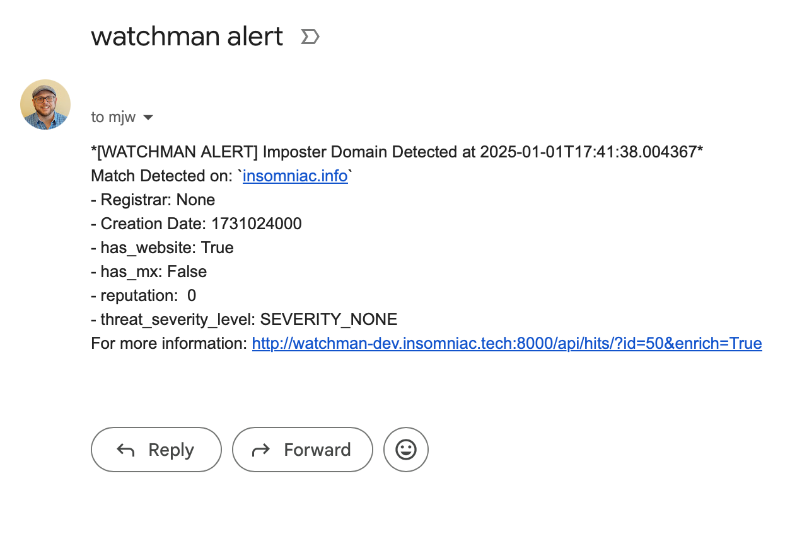
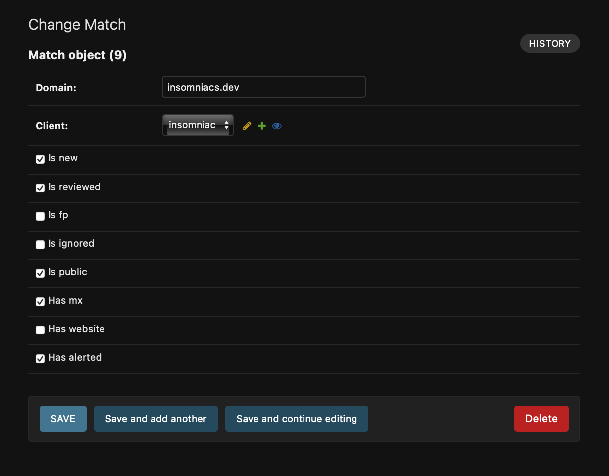
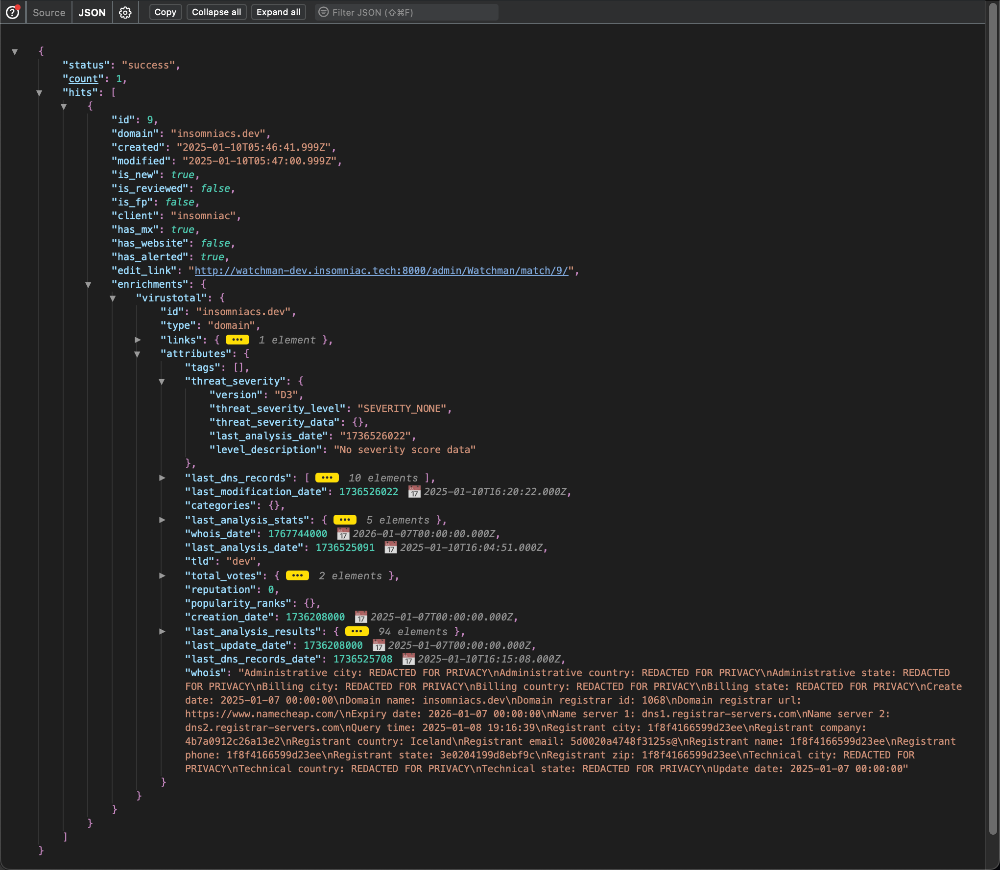

# Watchman

Watchman watches newly registered domains for lookalikes of the domains you care about, so you hear about phishing and impersonation domains when they're registered instead of after they're used against you.

Each day it downloads the gTLD zone files from ICANN's [Centralized Zone Data Service](https://czds.icann.org/) (CZDS), diffs them against the previous day to find newly registered domains, runs your searches against them, and alerts you on Slack or email about anything that matches.

More background: [Watchman slides](https://docs.google.com/presentation/d/10TtlZO01WfJo9raF-ShS06m5bak1NSG1/edit#slide=id.g324938c8159_1_85)

## How it works

```
ICANN CZDS ──download──▶ zone file ──▶ S3 (domain lists)
                              │
                     diff vs. previous day
                              │
                              ▼
                    new domains (Postgres) ──▶ S3 (new-domain lists)
                              │
                     run_searches (substring / regex / edit distance)
                              │
                              ▼
                     matches ──enrich (MX, website, VirusTotal)──▶ alerts (Slack, email)
```

`run-daily.sh` runs the whole pipeline: `update_zone` → `run_searches` → `run_alerts` → `purge_new`. Results are managed in the Django admin.

## Requirements

- Linux (Debian/Ubuntu or Amazon Linux) or macOS for development
- Python 3.12+ (the install scripts install it if it's missing)
- PostgreSQL and Redis (installed by `install.sh`)
- An [ICANN CZDS](https://czds.icann.org/) account with approved access to the zones you want to watch
- AWS credentials and two S3 buckets: one for full domain lists, one for new-domain lists
- Optional: a [VirusTotal](https://www.virustotal.com/) API key to enrich alerts



Request zone access in CZDS before installing. Approval is per zone and can take days; Watchman can only download zones you've been approved for.



## Install

```bash
git clone https://github.com/mwollenweber/Watchman.git
cd Watchman
cp example-config.rc config.rc
```

Edit `config.rc` (see [Configuration](#configuration)), then:

```bash
./install.sh
```

`install.sh` installs Postgres and Redis, creates the database and user, builds the Python virtualenv in `./env`, runs migrations, loads the zone list from CZDS, enables the zones in `ENABLED_ZONES`, and prompts you to create an admin user.

### Upgrade

Pull the latest code, update dependencies (rebuilding `./env` if Python needs upgrading), and run migrations:

```bash
./upgrade.sh [config-file]
```

## Configuration

`config.rc` is a shell file of `export` statements that every script sources. Pass a different file to any script to use another config (e.g. `prod.rc`).

| Variable | Description |
| --- | --- |
| `DBNAME`, `DBUSER`, `DBPASSWORD`, `DBHOST` | Postgres connection |
| `ICANN_USERNAME`, `ICANN_PASSWORD` | CZDS login |
| `ENABLED_ZONES` | Space-separated TLDs to download and search |
| `AWS_ACCESS_KEY_ID`, `AWS_SECRET_ACCESS_KEY`, `REGION_NAME` | AWS credentials for S3 (region defaults to `us-east-1`) |
| `DOMAIN_BUCKET_NAME` | S3 bucket for full domain lists |
| `NEWDOMAIN_BUCKET_NAME` | S3 bucket for new-domain lists |
| `VT_APIKEY` | VirusTotal API key (optional) |
| `BASE_URL` | Public URL of this server, used for links in alerts |

Less common settings, with defaults, are in [Watchman/settings.py](Watchman/settings.py): `MAX_NEW_AGE` (days a domain counts as new, 400), `MAX_TEMP_AGE` (days to keep files in `./tmp`, 31), `MIN_DOMAIN_LIST_LENGTH`, `DJANGO_LOG_LEVEL`, and others.

## Setting up monitoring

Start the web server and sign in to the admin at http://localhost:8000/admin/ with the user you created during install:

```bash
./run-server.sh [config-file]
```

### 1. Add a client

A client is the organization you're watching for. Searches, matches, and alerts all belong to a client.

http://localhost:8000/admin/Watchman/client/add/



### 2. Add searches

http://localhost:8000/admin/Watchman/search/add/

Each search runs against every new domain using one of three methods:

| Method | Matches when | Example criteria |
| --- | --- | --- |
| `substring` | The criteria appears anywhere in the domain (case-insensitive) | `insomniac` |
| `strdistance` | The [Levenshtein distance](https://en.wikipedia.org/wiki/Levenshtein_distance) between the domain and the criteria is less than **Tolerance** | `insomniac.tech` with tolerance `3` |
| `regex` | The regular expression matches from the start of the domain (case-insensitive) | `insomn[i1l]ac` |

A good starting point is two searches per domain: a `substring` search on the name without the TLD, and a `strdistance` search on the full domain. For `insomniac.tech` that's `insomniac` (substring) and `insomniac.tech` (strdistance), which catches both `insomniac-login.com` and `insomniak.tech`.



### 3. Add an alert config

http://localhost:8000/admin/Watchman/alertconfig/add/

Pick a client and alert type, and put the type's settings in the **Settings** JSON field:

| Alert type | Settings |
| --- | --- |
| `slackWebhook` | `{"webhook": "https://hooks.slack.com/services/..."}` |
| `slack` | `{"apikey": "xoxb-...", "channel": "#alerts"}` |
| `email` | `{"server": "smtp.example.com", "sender": "watchman@example.com", "password": "...", "recipient": "you@example.com", "subject": "Watchman alert"}` (SMTP over SSL, port 465) |

A client can have several alert configs; each match is sent to all of them. `gmail` is listed in the admin but not implemented yet.



Alerts include the matched domain, the search method, whether it has MX records and a website, and VirusTotal registrar, creation date, and reputation when `VT_APIKEY` is set.



## Running daily

```bash
./run-daily.sh [config-file] [--shutdown]
```

This downloads and diffs every zone in `ENABLED_ZONES`, runs searches, sends alerts for new matches, purges expired new domains, and deletes temp files older than 15 days. Run it once a day, from cron or at boot.

`--shutdown` powers the system off when the run finishes. The user running it needs permission to shut down without a password: root, a passwordless sudo rule for `shutdown`, or polkit permission to power off. If it doesn't have permission, the script exits before running.

### Run on every boot (systemd)

On systemd hosts such as Amazon Linux, install a service that runs `run-daily.sh` each time the system starts:

```bash
sudo ./install-startup.sh
```

| Option | Description |
| --- | --- |
| `--config FILE` | Config file to use (default `config.rc`) |
| `--user USER` | User to run as (default: the user who ran `sudo`; root is refused) |
| `--shutdown` | Power off after each run, and add a sudoers rule letting the user run only `shutdown -h now` without a password (checked with `visudo` before it's installed) |
| `--dry-run` | Print what would be installed without changing anything |
| `--uninstall` | Remove the service and sudoers rule |

For a once-a-day job on a cloud instance, schedule the instance to start each day and install with `--shutdown`:

```bash
sudo ./install-startup.sh --shutdown --config prod.rc
```

[docs/production-aws.md](docs/production-aws.md) documents the production setup: an EC2 instance that EventBridge Scheduler starts every morning and that stops itself after the run.

Logs:

```bash
journalctl -u watchman-daily
```

To keep the machine up for maintenance, stop the service after boot, before the run finishes:

```bash
sudo systemctl stop watchman-daily
```

## Reviewing matches

Matches show up in the admin at http://localhost:8000/admin/Watchman/match/. Mark false positives with **Is fp** so they stop alerting, and **Is public** to publish a reviewed match on the public feed.



## API

All endpoints return JSON. Most require a signed-in session.

| Endpoint | Auth | Description |
| --- | --- | --- |
| `GET /api/hits/` | User | Matches for your client (all clients for superusers). `?id=N` for one match, `&enrich=True` to add VirusTotal data. |
| `GET /api/public_hits/` | None | Reviewed, public, non-false-positive matches from the last 30 days |
| `GET /api/newdomains/` | None | New domains from the last 30 days |
| `GET /newdomainfiles/` | User | Page listing the latest day's new-domain list files in the `NEWDOMAIN_BUCKET_NAME` bucket, with download links. `?date=YYYY-MM-DD` for another day, `&format=json` for JSON. |
| `GET /newdomainfiles/<file>` | User | Redirects to a one-hour presigned S3 download URL for that file |
| `GET /api/isnod/?value=example.com` | User | Whether a domain is newly observed |
| `GET /api/search/?search_type=new_domain&value=foo` | User | Search new domains (`new_domain`, `domain`, or `nod`) |
| `GET /api/zonestatus/` | Superuser | Status and last update time of each enabled zone |



## Management commands

Run these from the virtualenv (`source config.rc && source env/bin/activate`):

| Command | Description |
| --- | --- |
| `python manage.py update_zone com net ...` | Download, diff, and load new domains for the given zones |
| `python manage.py run_searches` | Run active searches against new domains |
| `python manage.py run_alerts` | Send alerts for matches that haven't alerted yet |
| `python manage.py init_zones` | Load the list of zones available from CZDS |
| `python manage.py enable_zone ZONE ...` / `disable_zone ZONE` | Turn zones on or off |
| `python manage.py firstload_zonefile ZONE` | Load every domain in a zone into the `Domain` table (not part of the daily run) |
| `python manage.py diff_zone ZONE` | Diff the two most recent downloads of a zone |
| `python manage.py expire_new` / `purge_new` | Mark or delete new domains older than `MAX_NEW_AGE` |
| `python manage.py clean_tmp` | Delete temp files older than `MAX_TEMP_AGE` |
